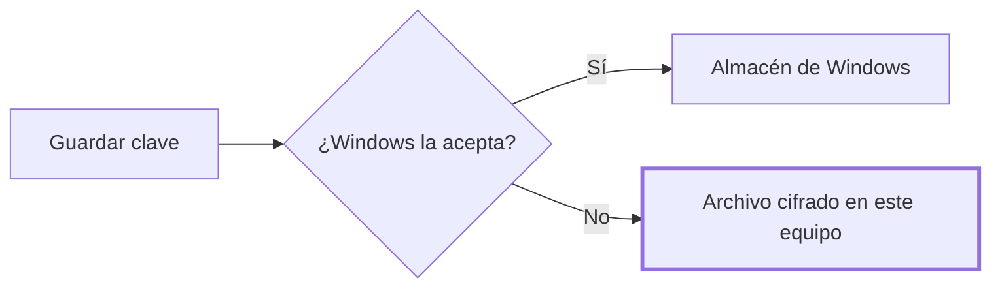

# CHG-002 · Diagnóstico y claves en equipos corporativos
**Estado:** Cerrado
**Nivel:** M
**Modelo sugerido:** estandar
<!-- Estados y nivel se cambian SOLO con node .claude/team.mjs. Modelo: un perfil de docs/TEAM_MODELS.md -->
**Creado:** 2026-11-04 · **Aprobado:** 2026-11-04 · **Cerrado:** 2026-11-04
**Relacionado:** CHG-003 (el diagnóstico también revisa `av`)

## 0. En palabras simples
- Qué vas a ver distinto: en Configuración habrá una sección que dice qué funciona y qué falta en ese computador, y cómo arreglarlo. La clave se podrá guardar aunque Windows bloquee su almacén, y un modelo instalado en tu equipo no pedirá clave.
- Cómo comprobarlo tú: en el portátil corporativo, abre el diagnóstico y lee el resultado. Luego pulsa "Buscar palabras", guarda una clave y usa "Probar conexión" con tu modelo local.

## 1. Resumen
En el portátil corporativo fallan "Palabras sospechosas" y el guardado de la clave, pero la app muestra mensajes genéricos, no deja registro y arranca sin consola (`pythonw`), así que no se conoce la causa. Este cambio hace visible el problema y da una alternativa cifrada para la clave. También elimina la clave obligatoria en modelos locales. La causa exacta de "Palabras sospechosas" se confirmará en el portátil tras T1.

## 2. Producto (product-manager)
- Problema / usuario: quien usa la app en un equipo con restricciones no puede saber qué falla ni resolverlo.
- Incluye: diagnóstico en Configuración, registro local de errores, mensajes que distinguen la causa, archivo cifrado como alternativa para la clave y modelos locales sin clave.
- No incluye: instalar dependencias desde la app, saltarse políticas corporativas, guardar claves en texto plano, audio Opus (CHG-003).
- Criterios de aceptación (Dado/Cuando/Entonces):
  - Dado un equipo sin `spylls`, cuando abro el diagnóstico, entonces lo veo marcado como faltante, con qué función afecta y qué hacer.
  - Dado que falla "Buscar palabras", cuando leo el error, entonces sé si es dependencia, diccionario o permisos, y la causa técnica queda en el registro.
  - Dado que Windows rechaza la clave, cuando la guardo, entonces queda cifrada en el archivo local y la interfaz dice dónde quedó.
  - Dado un modelo en `localhost` o `127.0.0.1` sin clave, cuando pruebo la conexión o ejecuto un análisis, entonces funciona.
  - Dado un proveedor en la nube sin clave, cuando intento usarlo, entonces se sigue rechazando.
  - Dado cualquier flujo, cuando reviso JSON, registro y diagnóstico, entonces la clave no aparece.

## 3. UX/UI (ux-designer)
- Flujo: Configuración → "Diagnóstico del equipo" → lista de comprobaciones con estado y acción sugerida → botón "Volver a comprobar" → enlace o ruta del registro.
- Componentes existentes a reutilizar (ruta): diálogo y estilos de Configuración en `static/manager.html`, `static/manager.css`, `static/manager.js`.
- Estados (vacío / carga / error / éxito / validaciones): "Comprobando…"; cada fila "Funciona" o "Falta/Bloqueado" con texto, no solo color; si falla el endpoint, mensaje con reintento. Junto a la clave: "Guardada en el almacén de Windows" o "Guardada cifrada en este equipo". Para URL local: "Clave opcional".
- Responsive y accesibilidad: lista en una columna dentro del diálogo existente, botones con teclado y resultado anunciado con `aria-live`.

## 4. Diseño técnico (software-architect)
- Archivos a crear / modificar: crear `diagnostics.py`, `credentials_store.py`, `test_diagnostics.py`, `test_credentials.py`; modificar `analysis.py`, `app.py`, `review.py`, `requirements.txt` si hace falta, `static/manager.html`, `static/manager.js`, `static/manager.css`, `README.md`.
- Enfoque y patrones a seguir:
  - `GET /diagnostics` importa con `importlib` `spylls`, `keyring`, `av`, `onnxruntime`, `faster_whisper`; carga diccionarios; prueba escritura en la carpeta de sesiones y comprueba el almacén con una credencial temporal que luego borra.
  - Registro con `logging` y rotación en `%LOCALAPPDATA%\Transcriptor\logs`. Nunca registra claves ni texto de transcripciones.
  - `review.py:243` y `app.py:1777,1793`: capturar `ImportError`/`OSError` aparte y registrar la excepción.
  - Claves: `Credentials` intenta Windows Credential Manager; si falla, usa un archivo DPAPI (`CryptProtectData` vía `ctypes`) en `%LOCALAPPDATA%\Transcriptor\credentials`, un archivo por `credential_id`, con `atomic_bytes`. Al leer, primero Windows y luego archivo. Borrar elimina en ambos. Guardar con éxito en uno elimina la copia del otro.
  - Local: extraer `is_local_url()` de `app.py:1231`; aplicarla en `app.py:1766,1772,1787` y `analysis.py:268,333,431,498`, enviando `'local'` como hace `insight_completion`. Usar `urlparse(...).hostname`, nunca buscar por texto.
- Riesgos y mitigación: DPAPI lo puede descifrar cualquier programa que corra con tu usuario (se documenta); la prueba de almacén podría dejar basura (se borra en `finally`); una política podría bloquear también DPAPI (se informa el error, sin texto plano).
- Qué NO tocar: formato de sesiones, audio, motores de transcripción.

## 5. Pruebas (qa-tester)
| Caso | Tipo | Nivel | Test |
|---|---|---|---|
| Dependencia ausente aparece como faltante | Unitaria | Alta | `test_diagnostics.py` |
| El diagnóstico no expone datos ni claves | Unitaria | Alta | `test_diagnostics.py` |
| Error de búsqueda distingue la causa y se registra | Unitaria | Alta | `test_review.py` |
| Windows falla y la clave pasa a DPAPI | Unitaria | Alta | `test_credentials.py` |
| Ida y vuelta DPAPI, reemplazo y borrado | Integración | Alta | `test_credentials.py` |
| Clave ausente en JSON y registro | Unitaria | Alta | `test_credentials.py` |
| Local sin clave pasa; nube sin clave se rechaza; `localhost.evil.com` cuenta como nube | Unitaria | Alta | `test_analysis.py` |
| Portátil corporativo real | Manual | Alta | Pasos de §0 |
- Comando para verificar: `python -m unittest discover -p "test_*.py"`
- Regresión a vigilar: credenciales ya guardadas en Windows siguen leyéndose; análisis automático e insights.

## 6. Documentación (tech-writer)
- Docs a actualizar: `README.md:271` (claves y alternativa cifrada) y nueva sección "Equipos corporativos" (diagnóstico, registro, reinstalar dependencias).

## 7. Tareas
- [x] T1 · Ver en Configuración qué funciona y qué falta en el equipo — Resp: dev-implementer — Modelo: estandar — Archivos: diagnostics.py, app.py, static/manager.html, static/manager.js, static/manager.css, test_diagnostics.py — Hecho cuando: el diagnóstico lista dependencias, diccionarios, escritura y almacén, y sus tests pasan
- [x] T3 · Probar T1 en el portátil — Resp: qa-tester — Hecho cuando: el usuario revisa el panel en el portátil
- [x] T6 · Verificar el diagnóstico en el portátil — Resp: qa-tester — Hecho cuando: el usuario confirma el resultado del panel
- [x] T7 · Actualizar documentación — Resp: tech-writer — Archivos: README.md — Hecho cuando: el README explica el diagnóstico

## 8. Bitácora de implementación (dev-implementer)
- 2026-11-04 — Inicio. Base: 195 tests en verde.
- 2026-11-04 — T1: `GET /diagnostics` y panel en Configuración. Archivos: diagnostics.py, test_diagnostics.py, app.py, static/manager.html, static/manager.js, static/manager.css. Verificación: suite completa 202 OK; endpoint real en este PC, 8 comprobaciones OK. Sin revisar: el panel en pantalla.
- 2026-11-04 — T3/T6: el usuario informa que en el portátil el panel salió con todo en "Funciona". No se confirmó aquí ni se volvieron a probar "Buscar palabras" y guardar la clave.
- 2026-11-04 — T7: README, sección de diagnóstico.

## 9. Preguntas abiertas, decisiones e historial
- 2026-11-04 — Creado en to-do/ (Borrador, nivel M)
- 2026-11-04 — Decisión del usuario: portátil primero; clave en archivo cifrado con DPAPI y opcional en modelos locales.
- 2026-11-04 — Roles cubiertos por dev-team-lead: el repo no tiene aún `docs/PRODUCT.md`, `ARCHITECTURE.md`, `UX-DESIGN.md`, `TESTING.md` ni `DOCUMENTATION.md`, y esas skills de rol no están disponibles en esta sesión.
- Hipótesis sin confirmar: el portátil no tiene `spylls` o `keyring`, o una política bloquea el almacén de Windows. T3 lo resuelve.
- 2026-11-04 — Aprobado por el usuario (Compuerta 2)
- 2026-11-04 — Movido a in-progress/ (En desarrollo)
- 2026-11-04 — Decisión del usuario: reducir el alcance al diagnóstico y cerrar. Retiradas sin implementar: T2 (errores y registro), T4 (clave cifrada), T5 (modelo local sin clave). Los criterios de §2 y el diseño de §4 sobre ellas no aplican a esta entrega; de aquí se puede partir si reaparecen los fallos.
- 2026-11-04 — Causa de los fallos originales sin determinar: el panel no detectó problema alguno.
- 2026-11-04 — Implementación terminada → En verificación
- 2026-11-04 — Cerrado por el usuario (Compuerta 3) → done/
