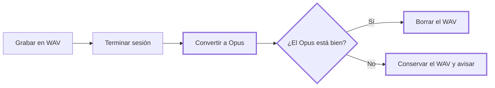

# CHG-003 · Audio de sesiones en Opus
**Estado:** Aprobado
**Nivel:** M
**Modelo sugerido:** estandar
<!-- Estados y nivel se cambian SOLO con node .claude/team.mjs. Modelo: un perfil de docs/TEAM_MODELS.md -->
**Creado:** 2026-11-04 · **Aprobado:** 2026-11-04 · **Cerrado:** —
**Relacionado:** CHG-002 (se implementa después)

## 0. En palabras simples
- Qué vas a ver distinto: una hora de reunión ocupará unos 11 MB en vez de hasta 230 MB. Al terminar la sesión el audio se comprime solo, y un botón comprime las sesiones que ya tienes.
- Cómo comprobarlo tú: graba una reunión, termina, mira el tamaño en la carpeta `.session`, escúchala y salta a varios momentos. Luego pulsa el botón en una sesión antigua.

## 1. Resumen
El respaldo se guarda en WAV sin comprimir y llena OneDrive. Se seguirá grabando en WAV, porque resiste cierres inesperados, y se convertirá a Opus de 24 kbps al terminar. El WAV solo se borra tras comprobar el Opus. Las sesiones antiguas se convierten con un botón.

## 2. Producto (product-manager)
- Problema / usuario: quien guarda sesiones en OneDrive agota su capacidad con pocas reuniones.
- Incluye: conversión automática al terminar, botón para sesiones antiguas, reproducción de WAV y Opus, canales Yo/Otros separados.
- No incluye: calidad configurable, cambiar la carpeta de grabación, comprimir durante la grabación, borrar audio sin un Opus válido.
- Criterios de aceptación (Dado/Cuando/Entonces):
  - Dada una sesión con respaldo, cuando termina, entonces cada WAV queda como `.ogg` y la sesión pesa unos 11 MB por hora.
  - Dado un fallo de conversión o verificación, cuando ocurre, entonces el WAV sigue intacto, la sesión se reproduce y aparece un aviso.
  - Dado un cierre de la app durante la conversión, cuando vuelvo a abrirla, entonces no se pierde audio y puedo reintentar con el botón.
  - Dada una sesión convertida o mixta, cuando reproduzco y salto entre partes, entonces funciona igual que antes.
  - Dadas sesiones antiguas, cuando pulso el botón y confirmo, entonces veo el progreso, se saltan las ya convertidas y veo el espacio liberado.
  - Dado el audio convertido, cuando se analiza por canales, entonces Yo sigue a la izquierda y Otros a la derecha.

## 3. UX/UI (ux-designer)
- Flujo: al terminar, la sesión queda disponible y se convierte en segundo plano. Configuración → "Comprimir audio de sesiones antiguas" → confirmación con espacio estimado → progreso → resumen.
- Componentes existentes a reutilizar (ruta): `audioStatus` y `notify` en `static/manager.js`; diálogo de Configuración en `static/manager.html`.
- Estados (vacío / carga / error / éxito / validaciones): sin WAV: "No hay audio por comprimir". En curso: "Comprimiendo audio… parte 2 de 4". Éxito: "Se liberaron 690 MB". Error: "No se pudo comprimir N sesiones; su audio original se conserva". El reproductor funciona mientras se convierte, con el WAV hasta que el manifiesto cambie.
- Responsive y accesibilidad: progreso como texto con `aria-live`; botón deshabilitado durante el proceso.

## 4. Diseño técnico (software-architect)
- Archivos a crear / modificar: crear `audio_compress.py`, `test_audio_compress.py`; modificar `app.py`, `session_repository.py`, `requirements.txt`, `static/manager.html`, `static/manager.js`, `README.md`.
- Enfoque y patrones a seguir:
  - `audio_compress.py` con PyAV: `libopus`, 24 kbps, estéreo, sin mezclar canales, remuestreo a 48 kHz. Escribe `audio-NNNN.ogg.tmp`, valida decodificando y lo renombra a `.ogg`.
  - Verificación: la duración decodificada coincide con el WAV (tolerancia de 0,5 s) y hay dos canales.
  - Orden seguro: Opus válido → `session.json` actualizado con `atomic_json` → borrar WAV. Un cierre entre pasos deja, como mucho, un archivo de más; el botón limpia solo un WAV cuyo `.ogg` referenciado ya esté validado.
  - Disparo: en un único hilo de trabajo en segundo plano, después de `session_finished` (`app.py:932`), fuera de `self.lock`. Solo sesiones `finished`: `recording.py:110` reabre WAV únicamente durante la grabación.
  - Si una sesión se borra o está siendo convertida, las operaciones concurrentes sobre ella esperan o se rechazan con un mensaje, con un bloqueo por sesión.
  - Lectura: aceptar `.wav` y `.ogg` en `session_repository.py:139` y `app.py:1983`; `media_type` según extensión en `app.py:1673,2003`.
  - Declarar `av` en `requirements.txt`.
- Riesgos y mitigación: pérdida de audio (orden seguro y verificación); OneDrive o antivirus bloquean el archivo (reintentos como en `atomic_bytes`, y si fallan se conserva el WAV); salto impreciso en Ogg con WebView2 (se comprueba en T2 antes de seguir; si falla, se detiene y se pregunta); uso de CPU (un solo hilo, de una parte a la vez).
- Qué NO tocar: captura y escritura en vivo (`AudioBackup`), transcripción, `download.py` (no maneja audio).

## 5. Pruebas (qa-tester)
| Caso | Tipo | Nivel | Test |
|---|---|---|---|
| Conversión reduce tamaño y conserva duración | Integración | Alta | `test_audio_compress.py` |
| Canales izquierdo y derecho siguen separados | Integración | Alta | `test_audio_compress.py` |
| Fallo de codificación o verificación conserva el WAV y el manifiesto | Unitaria | Alta | `test_audio_compress.py` |
| Cierre simulado entre cada paso no pierde audio | Unitaria | Alta | `test_audio_compress.py` |
| Sesión mixta se valida y se sirve con su tipo | Integración | Alta | `test_sessions.py` |
| Referencias `../x.ogg` y otras extensiones se rechazan | Unitaria | Alta | `test_sessions.py` |
| Lote salta lo convertido y sigue tras un error | Unitaria | Media | `test_audio_compress.py` |
| Reunión real: tamaño, calidad y saltos en WebView2 y navegador | Manual | Alta | Pasos de §0 |
- Comando para verificar: `python -m unittest discover -p "test_*.py"`
- Regresión a vigilar: `test_recording.py` y `test_sessions.py` (que leen WAV), pausa y reanudación, activar y desactivar respaldo, borrar sesión.

## 6. Documentación (tech-writer)
- Docs a actualizar: `README.md:221` (formato, tamaño por hora, WAV temporal, botón de compresión).

## 7. Tareas
- [ ] T1 · Convertir un WAV a Opus de forma segura, sin perder el original si algo falla — Resp: dev-implementer — Modelo: estandar — Archivos: audio_compress.py, requirements.txt, test_audio_compress.py — Hecho cuando: los casos de conversión y fallo de §5 pasan
- [ ] T2 · Reproducir y saltar en sesiones con audio Opus — Resp: dev-implementer — Modelo: estandar — Archivos: app.py, session_repository.py, static/manager.js, test_sessions.py — Hecho cuando: una sesión mixta se reproduce y salta en WebView2 y navegador, y las referencias inválidas se rechazan
- [ ] T3 · Comprimir automáticamente al terminar cada sesión — Resp: dev-implementer — Modelo: estandar — Archivos: app.py, audio_compress.py, static/manager.js, test_audio_compress.py — Hecho cuando: al terminar, los WAV se reemplazan sin bloquear la interfaz y un fallo muestra aviso y conserva el WAV
- [ ] T4 · Botón para comprimir sesiones antiguas — Resp: dev-implementer — Modelo: estandar — Archivos: app.py, audio_compress.py, static/manager.html, static/manager.js, test_audio_compress.py — Hecho cuando: pide confirmación, muestra progreso, salta lo convertido y reporta el espacio liberado
- [ ] T5 · Verificar criterios de aceptación con una reunión real — Resp: qa-tester — Hecho cuando: todos los criterios de §2 pasan y se anota el MB/hora medido en §8
- [ ] T6 · Actualizar documentación — Resp: tech-writer — Archivos: README.md — Hecho cuando: §6 está al día

## 8. Bitácora de implementación (dev-implementer)

## 9. Preguntas abiertas, decisiones e historial
- 2026-11-04 — Creado en to-do/ (Borrador, nivel M)
- 2026-11-04 — Decisión del usuario: Opus a 24 kbps; sesiones antiguas con botón.
- 2026-11-04 — Roles cubiertos por dev-team-lead: el repo no tiene aún los lineamientos en `docs/`, y esas skills de rol no están disponibles en esta sesión.
- Nota: 11 MB/hora es un cálculo (24 kbps), no una medición. T5 lo confirma.
- 2026-11-04 — Aprobado por el usuario (Compuerta 2)
